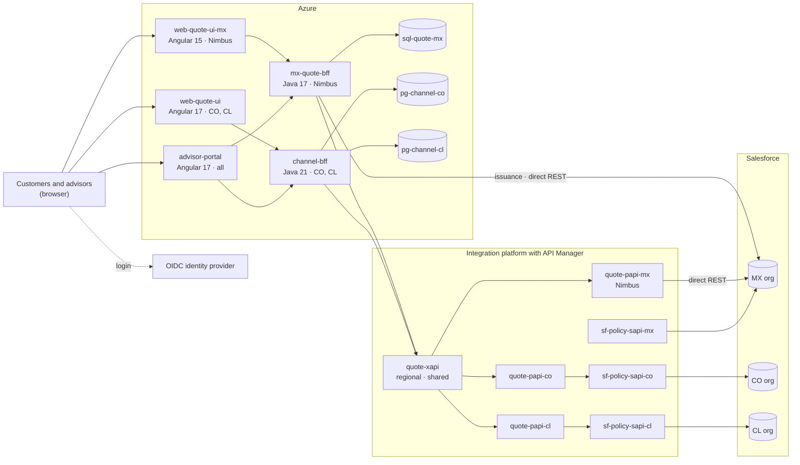

# Current state — Direct Digital Channel

> State as of 15 September 2026, two weeks before incident INC-0907.

## Overview

## Component inventory

| Component | Type | Countries | Owner | Technology | Notes |
|---|---|---|---|---|---|
| `web-quote-ui` | Frontend | CO, CL | Internal | Angular 17 | Chile keeps 23 country-specific copies of shared components |
| `web-quote-ui-mx` | Frontend | MX | Nimbus | Angular 15 | Forked in 2023 |
| `advisor-portal` | Frontend | All | Internal | Angular 17 | Workforce realm; calls the BFF of the country being served |
| `channel-bff` | BFF | CO, CL | Internal | Java 21, Spring Boot 3, Container Apps | Intended to become the BFF for the three countries |
| `mx-quote-bff` | BFF | MX | Nimbus | Java 17, Spring Boot 2.7, App Service | Issues policies by calling the MX org directly |
| `quote-xapi` | Experience API | All | Internal | MuleSoft | Regional since 2026-Q2; one deployment shared by the three countries |
| `quote-papi-co`, `quote-papi-cl`, `quote-papi-mx` | Process API | One each | Internal (CO, CL), Nimbus (MX) | MuleSoft | About 70% of the logic is duplicated; `quote-papi-mx` calls the MX org directly |
| `sf-policy-sapi-co`, `-cl`, `-mx` | System API | One each | Salesforce platform team | MuleSoft | `sf-policy-sapi-mx` exists, but the Mexican quote flow does not use it yet |
| `pg-channel-co`, `pg-channel-cl` | Database | One each | Internal | Azure Database for PostgreSQL | Quote drafts and session data. Also used by a monthly reporting job |
| `sql-quote-mx` | Database | MX | Nimbus | Azure SQL | Quote drafts |

## Runtime facts relevant to resilience

**`quote-xapi`**
- Two replicas. Each replica processes at most **64 requests in flight**; up to **100** more wait in a queue, and further requests are rejected with `503`.
- The three countries share the same replicas, the same in-flight limit and the same queue.
- Outbound HTTP timeout to every Process API: **30 s**. No circuit breaker.
- Routes each request to the Process API of the country in the request.
- API Manager policies: client ID enforcement and JWT validation (keys from the identity provider's JWKS endpoint, cached).

**`quote-papi-co` and `quote-papi-cl`**
- Cache the rating tables in memory and refresh them daily after publication.
- Timeout to the System API: 5 s, one retry after 1 s.

**`quote-papi-mx`** (Nimbus)
- Timeout to Salesforce: 5 s.
- Release notes are kept in Nimbus's repository; Meridian receives them with the deployment notification.

**`channel-bff`**
- Validates JWTs (issuer, audience, signature) and takes the customer and the country from the token claims.
- Calls `quote-xapi` with a 4 s read timeout and a circuit breaker.

## Identity

- Customer tokens include `sub` (customer ID in the identity provider), `ctry` (country of the customer account: `MX`, `CO` or `CL`) and `sf_account_id` (the customer's account in the Salesforce org of that country).
- Workforce tokens include `sub`, `countries` (the countries the advisor may serve) and `roles`.

## Environments and delivery

- Environments: development, UAT and production, per country.
- Internal components are deployed through Azure Pipelines.
- Nimbus deploys `web-quote-ui-mx`, `mx-quote-bff` and `quote-papi-mx` from its own CI, with a deployment credential provided by Meridian.

## Cells and teams around the Direct Digital Channel

| Cell or team | Relationship with the Direct Digital Channel |
|---|---|
| Payments Integration | Owns payment collection and the integration with payment providers. Publishes payment events that the channel uses to show payment status. Shares the Salesforce API allocation of each org. |
| Salesforce platform team | Owns the orgs, the product configuration and the System APIs. |
| Communications | Owns notification templates and sending. The channel requests messages (quote summary, policy issued) through a Process API owned by Communications. |
| Claims | Owns claims. The self-service portal shows claim status through an Experience API owned by Claims. |
| Data & Analytics | Consumes channel events for funnel analytics. |
| Security office | Approves exceptions to security standards and runs penetration tests. |
| Architecture office | Maintains enterprise standards and facilitates the architecture forum. Each cell's Technical Lead owns the architecture of the cell. |
